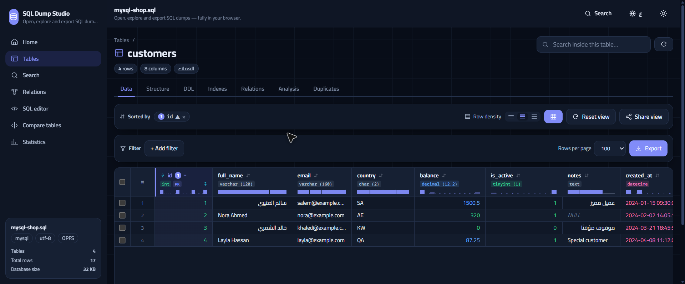
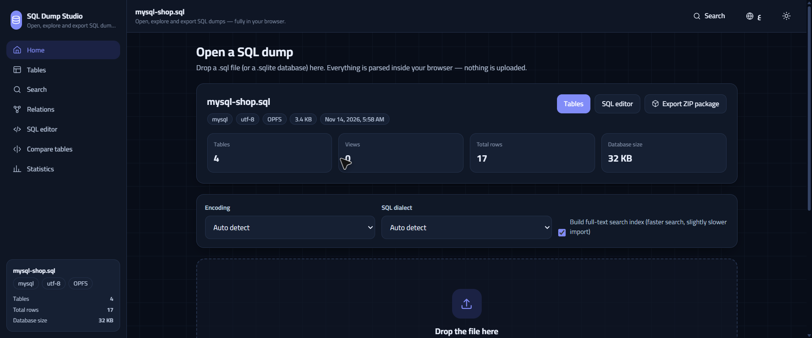
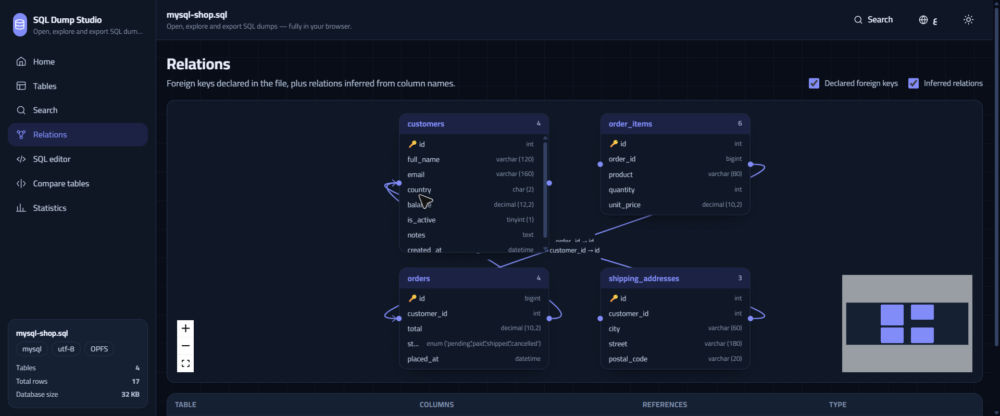

<div align="center">



# 🗄️ SQL Dump Studio

**Open any SQL dump in your browser — explore the tables, run queries, and export the data.**
*Nothing is ever uploaded. Parsing, indexing, querying and exporting all happen locally.*

[](https://github.com/adce626/sql-dump-studio/actions/workflows/ci.yml)
[](LICENSE)
[](https://react.dev)
[](https://vite.dev)
[](https://www.typescriptlang.org)
[](https://www.sqlite.org/wasm/)
[](https://web.dev/articles/pwa)
[](#privacy)

</div>

---

## ✨ Highlights

| | Feature | What it does |
|---|---|---|
| 📂 | **Open SQL dumps** | Drag & drop a `.sql` file (MySQL / PostgreSQL / SQL Server / SQLite) or a native `.sqlite` database |
| 📊 | **Spreadsheet-style data grid** | Virtualized rows **and** columns, multi-column sorting, pinned columns, drag-to-resize, auto-fit, density modes, gridline toggle |
| 🔎 | **Search** | Full-text search (FTS5) across every table, plus per-column quick filters with value counts and inline match highlighting |
| 🧩 | **Relations** | Interactive ER diagram (declared foreign keys **and** inferred `x_id → x.id` links) |
| 🧪 | **SQL editor** | Run real SQL against the imported data, autocomplete for tables/columns/keywords, and a one-key formatter |
| 📈 | **Data analysis** | Per-column profiling (nulls %, distinct, min/max, avg, sum, top values), duplicate-row detection, and a side-by-side table diff |
| 🖼️ | **Images & blobs** | BLOB columns are sniffed and rendered as real thumbnails with a lightbox, zoom and download (PNG, JPEG, GIF, WEBP, SVG …) |
| 📤 | **Export** | CSV (UTF-8 BOM), JSON, NDJSON, SQL dump, XLSX (hand-written writer) — or a full **ZIP package** with `schema.sql`, per-table CSVs and the extracted images |
| 🔗 | **Shareable views** | Every table view (sort, filters, density, column widths) can be encoded into a URL and shared |
| ⌨️ | **Keyboard shortcuts** | `?` shows the full map — `g`+key navigation, `/` to search, `Ctrl+Shift+C` to copy rows |
| 🌍 | **Bilingual & offline** | English ⇄ Arabic with full RTL/LTR mirroring, dark & light themes, self-hosted fonts, and a service-worker PWA |

---

## 📸 Screenshots

<table>
<tr>
<td width="50%"></td>
<td width="50%"></td>
</tr>
<tr>
<td colspan="2" align="center"></td>
</tr>
</table>

---

## 🚀 Quick start

```bash
git clone https://github.com/adce626/sql-dump-studio.git
cd sql-dump-studio
npm install
npm run dev        # http://localhost:5173
```

```bash
npm run build      # production bundle → dist/
npm run preview    # serve the production build locally
npm run lint       # oxlint
```

> **Heads-up:** the dev server sends `COOP` / `COEP` headers, which are required for the persistent
> OPFS database. On a static host without those headers everything still works — the database simply
> lives in memory instead of on disk.

### Try it with the bundled samples

```
test/fixtures/mysql-shop.sql       # MySQL: 4 tables, foreign keys, Arabic text
test/fixtures/postgres-sports.sql  # PostgreSQL: COPY blocks
test/fixtures/duplicates.sql       # duplicate rows + a second version of a table
test/fixtures/wide-table.sql       # 60 columns — for the horizontal virtualization
test/fixtures/mysql-images.sql     # BLOB images, data-URIs and a PDF
```

---

## 🧩 Supported dialects

| Dialect | Highlights |
|---|---|
| **MySQL / MariaDB** | `AUTO_INCREMENT`, `ENGINE=`, `/*!40101 … */`, `UNIQUE KEY`, `ENUM`, multi-row `INSERT`, hex blobs (`0x…` / `X'…'`) |
| **PostgreSQL** | `SERIAL`, `public.`-qualified names, `COPY … FROM stdin` blocks, `E'…'` escapes |
| **SQL Server / T-SQL** | `[identifier]` quoting, `IDENTITY` |
| **SQLite** | native `.sqlite` files (detected by magic bytes) and `AUTOINCREMENT` |
| **Generic** | any dump following standard `CREATE TABLE` / `INSERT` syntax |

---

## 🏗️ Architecture

```
src/
├── worker/                 # runs in a Web Worker — never blocks the UI
│   ├── protocol.ts         # shared request/response contracts
│   ├── worker.ts           # RPC entry point + session management
│   ├── importer.ts         # streaming import of a dump into SQLite
│   ├── queries.ts          # rows, search, relations, stats, analysis, diff
│   ├── export.ts           # CSV / JSON / NDJSON / SQL / XLSX writers
│   ├── package.ts          # full ZIP package builder
│   ├── sqlite.ts           # sqlite-wasm bootstrap + OPFS helpers
│   └── sql/                # the parser: splitter, ddl, dml, values, dialect, lex
├── components/             # DataGrid (hand-written), ER diagram, SQL viewer, charts…
├── pages/                  # Home, Tables, Table, Search, Relations, Editor, Compare, Stats
├── i18n/                   # en.ts / ar.ts + provider (RTL & LTR)
├── theme/                  # dark / light theme
├── store/                  # data provider (sessions, file state)
└── lib/                    # worker client, formatting, SQL formatter, share links
```

**How it works**

1. The file is read **streaming** (`File.stream()`) inside the worker — no full-file buffering.
2. It is split into statements, respecting comments, strings, `DELIMITER` and `COPY` blocks.
3. SQLite tables are created from the `CREATE TABLE` definitions, keeping types, indexes and foreign keys.
4. Rows are inserted from `INSERT` and `COPY`, converting NULLs, escapes, dates and binary blobs.
5. An optional **FTS5** index is built for instant full-text search.
6. The UI then talks to the database through **real SQL** — sorting, filtering, searching and joining.

Everything runs against SQLite compiled to WebAssembly, with the database persisted in **OPFS**
(Origin Private File System) so a session can be restored the next time you open the app.

---

## ⌨️ Keyboard shortcuts

| Shortcut | Action |
| --- | --- |
| `?` | Show / hide the shortcuts panel |
| `/` or `Ctrl`/`Cmd` + `K` | Jump to search |
| `Ctrl`/`Cmd` + `Shift` + `C` | Copy the selected rows |
| `g` then `h` `t` `s` `r` `e` `c` `p` | Go to Home / Tables / Search / Relations / Editor / Compare / Statistics |
| `↑` `↓` | Move the open row |
| `Esc` | Close the open panel |

---

## 🔒 Privacy

Parsing, indexing, querying and exporting all happen **inside your browser**. No file is ever sent
to a server — there is no backend at all. Once installed as a PWA, the whole app works offline.

---

## 🧰 Tech stack

`React 19` · `Vite 8` · `TypeScript` · `Tailwind CSS v4` · `@sqlite.org/sqlite-wasm` (OPFS) ·
`@tanstack/react-virtual` · `React Flow` · `Prism.js` · `fflate` · `vite-plugin-pwa`

---

## 📄 License

[MIT](LICENSE) © 2026 adce626
